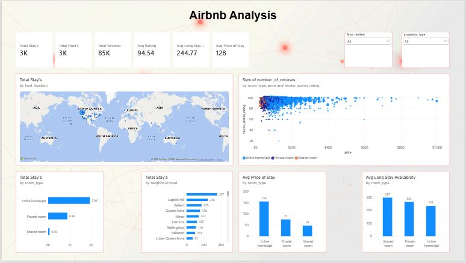
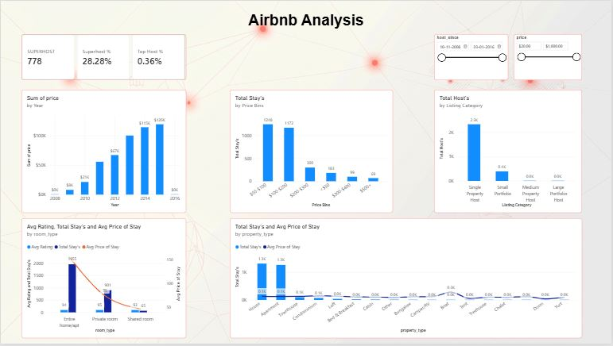

# Airbnb-Analytics-PowerBI
interactive Power BI dashboard analyzing Airbnb stays, pricing trends, room types, host metrics, and neighborhood demand.
# 🏡 Airbnb Analytics Dashboard
An interactive **Power BI** data analytics project designed to explore and analyze Airbnb listings, pricing strategies, host distribution, room types, and neighborhood availability.
---
## 📊 Project Overview
This project provides key business insights into short-term rental performance. By analyzing metrics such as average ratings, prices, long-stay availability, and host categorizations (Superhost's vs. Regular hosts), this dashboard helps identify pricing drivers and market demand patterns across various property types and regions.
---
## 📈 Key Metrics & KPIs
* **Total Stays:** 3K
* **Total Hosts:** 3K
* **Total Reviews:** 85K
* **Average Rating:** 94.54
* **Average Price of Stay:** $128
* **Average Long Stay Availability:** 244.77 days
* **Superhost Count:** 778 (28.28% of total hosts)
* **Top Host Percentage:** 0.36%
---
## 📑 Dashboard Pages & Preview
### 1. Home / Overview Dashboard
* Displays key summary KPIs, global listing locations map, price vs. rating scatter distribution, neighborhood breakdown, room type pricing, and availability.

### 2. Insights Dashboard
* Deep dives into revenue trends over time, price bins distribution, host listing categories (Single vs. Portfolio hosts), room type comparisons, and property type details (House, Apartment, Townhouse, etc.).

---
## 🔍 Key Findings & Insights
1. **Room Type Preferences:** Entire home/apartments represent the vast majority of total stays (~2.0K) and command the highest average price ($156).
2. **Neighborhood Demand:** Capitol Hill, Ballard, and Queen Anne are among the top-performing neighborhoods by total stays.
3. **Host Distribution:** A significant majority of hosts (~2.3K) manage a single property, with only a small fraction managing large portfolios.
4. **Price Binning:** Most stays fall within the $50–$100 and $100–$200 price ranges.
---
## 🛠️ Tools & Technologies Used
* **Power BI Desktop:** Data transformation, DAX metrics, interactive visuals, and canvas design.
* **GitHub:** Portfolio hosting and project documentation.
---
## 💡 Conclusion
The **Airbnb Analytics Dashboard** successfully translates complex short-term rental data into actionable business intelligence. Through strategic visualization of pricing distributions, host performance, and geographic demand, the analysis demonstrates that property type and location are primary levers for rental revenue. This portfolio project underscores the value of interactive BI tools in evaluating real estate performance and guiding data-driven hospitality management decisions.
---

## 👤 Author
**Harsha  Vardhan Kolagani**  
* [LinkedIn Profile](https://www.linkedin.com/in/harshavardhank189/) | [Portfolio/Website](https://github.com/harshak555)
